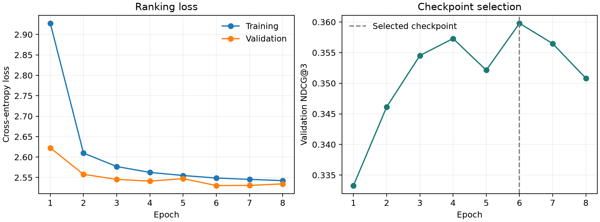

# First results on real Endomondo data

18 November 2026

We trained the GRU to predict the category of a runner's next completed session.
This first experiment uses duration and speed categories. It evaluates ranking without a time-budget constraint.

## Test results

All methods use the same candidate catalogue and the same test cases.

| Method | Recall@1 | Recall@3 | NDCG@3 | NDCG@10 | Recall@20 |
| --- | ---: | ---: | ---: | ---: | ---: |
| Random | 5.1% | 11.3% | 0.0849 | 0.1894 | 82.0% |
| Global popularity | 8.6% | 18.0% | 0.1394 | 0.2660 | 85.7% |
| Personal popularity | 23.0% | 46.5% | 0.3680 | 0.4762 | 94.3% |
| Repeat last category | 22.7% | 31.9% | 0.2806 | 0.3893 | 90.2% |
| GRU | 23.6% | 48.0% | 0.3784 | 0.5015 | 97.4% |
| GRU with history removed | 4.7% | 15.0% | 0.1032 | 0.2092 | 83.0% |

The GRU retrieves the observed category in its top three for 319 of 665 test sessions. Global popularity retrieves 120 and personal popularity retrieves 309.

History is useful in this experiment. The GRU is slightly ahead of personal popularity, but the difference is small. This is one run, so we cannot claim a reliable improvement over that baseline yet.

The zero-history GRU is a diagnostic: we remove the input history from the same trained network. It is not retrained for cold start. The planned new-user fallback remains global popularity.

## Protocol

- 24 shared categories, built from up to six training-duration quantile bands and four training-speed quantile bands. 24 categories occur in training.
- Catalogue boundaries, missing-heart-rate imputation and feature scaling are fitted on training data only.
- Runs with missing, nonpositive or above-10 m/s GPS average speed are excluded. This removes 18 sessions across the source splits.
- 68,405 training examples, 664 validation sessions and 665 test sessions from 665 test runners.
- Up to 10 earlier sessions per example. The input features are log-duration, speed, log-time-gap, mean heart rate and a missing-heart-rate flag. Altitude is excluded from this first model because of sensor noise.
- A target never appears in its own context. Validation uses earlier training events. Test context may also include earlier validation events. Other test events are excluded. Splits are per user, not a global calendar cutoff.
- Global popularity counts all training events. Personal popularity counts the same recent history visible to the GRU, with global popularity used to break ties. Repeat-last puts the previous category first. Random uses a fixed seed.
- 8 epochs, seed 42, Adam at 0.001, batch size 256. The checkpoint from epoch 6 was selected by validation NDCG@3. Test scores were not used to select it.
- Metrics are averaged per runner. Each of the current test runners has one target, so Recall@K is also hit rate.
- With 24 categories, @20 is a broad cutoff. @1 and @3 are more informative for this first catalogue.

## Category boundaries

Internal duration boundaries, in minutes: 40.10, 50.13, 60.07, 71.90, 95.76.

Internal speed boundaries, in km/h: 9.42, 10.72, 11.93.

A value equal to a boundary goes into the higher band. Template ID = 1 + duration-band-index × 4 + speed-band-index, with zero-based band indices. These categories are provisional and describe recorded traces, which can be shorter than complete workouts.

## Learning curves



## Three examples

These are the first three test cases in user-ID order. IDs below are category IDs, not users.

| Example | Observed category | Global top 3 | Personal top 3 | GRU top 3 |
| --- | ---: | --- | --- | --- |
| 1 | 13 | [21, 8, 4] | [17, 21, 11] | [17, 21, 13] |
| 2 | 1 | [21, 8, 4] | [5, 17, 6] | [5, 1, 9] |
| 3 | 12 | [21, 8, 4] | [12, 8, 4] | [8, 12, 4] |

## Limits and next work

This predicts a coarse category of an observed next workout. It does not establish which workout improves fitness. The small GRU-versus-personal-popularity gap needs repeated seeds and uncertainty estimates. The GPS speed filter does not remove every possible sensor error. The duration and speed groups also need product-level review.

The effort head remains untrained and frozen in this run. Effort calibration, conformal risk control, LLM parsing, time-constrained ranking and serving the trained checkpoint through the API remain pending.

## Reproduce

From the repository root, with the processed dataset already present:

```text
python -m pip install -r requirements-results.txt
python -m strideplan.experiment
python -m strideplan.report_experiment
```

The checkpoint and local experiment outputs are saved under artifacts/first_results, which is excluded from Git. The aggregate metrics in first_results.json and this report contain no user identifiers. Use a different --output directory to preserve this run when starting another experiment.
