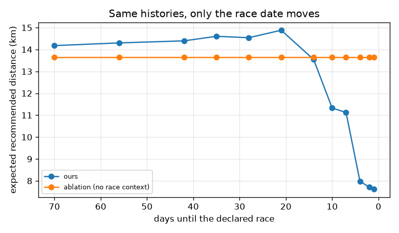
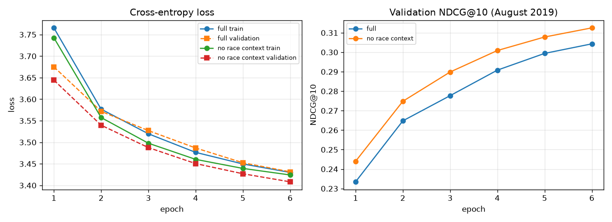

# Marathon recommender: offline results

Test period: September to December 2019, 694,116 target sessions from 15,097 runners. Full ranking of all 66 session types. Metrics are averaged per runner, then across runners. The checkpoint of each model was selected on validation NDCG@10 (August); the test split was used once.

## Test results

| Method | NDCG@10 | Recall@20 | Recall@10 | MRR |
| --- | ---: | ---: | ---: | ---: |
| Context-aware Transformer (ours) | 0.3225 | 0.7953 | 0.5865 | 0.2634 |
| Ablation: same model without race context | 0.3231 | 0.7904 | 0.5836 | 0.2649 |
| Personal popularity | 0.2555 | 0.6636 | 0.4745 | 0.2129 |
| Repeat last session type | 0.2156 | 0.6371 | 0.4140 | 0.1824 |
| Popularity per preparation phase | 0.2020 | 0.6314 | 0.4038 | 0.1683 |
| Most popular | 0.1992 | 0.6240 | 0.3972 | 0.1668 |
| Random | 0.0688 | 0.3040 | 0.1517 | 0.0723 |

## Ablation and significance

Paired bootstrap over runners (1,000 resamples). A difference is reliable when its 95% interval excludes 0.

| Comparison | Mean difference | 95% interval |
| --- | ---: | ---: |
| ndcg@10: ours - no_race_context, all test targets | -0.0005 | [-0.0012, +0.0001] |
| ndcg@10: ours - personal_popular, all test targets | +0.0670 | [+0.0658, +0.0683] |
| ndcg@10: ours - most_popular, all test targets | +0.1233 | [+0.1214, +0.1251] |
| ndcg@10: ours - no_race_context, taper (race in 0-3 weeks) | +0.0370 | [+0.0350, +0.0392] |
| ndcg@10: ours - no_race_context, peak (4-10 weeks out) | -0.0010 | [-0.0031, +0.0011] |
| ndcg@10: ours - no_race_context, post-race recovery (0-8 weeks after) | -0.0006 | [-0.0022, +0.0009] |
| ndcg@10: ours - no_race_context, no race context | -0.0094 | [-0.0105, -0.0085] |
| recall@20: ours - no_race_context, all test targets | +0.0049 | [+0.0040, +0.0059] |
| recall@20: ours - personal_popular, all test targets | +0.1318 | [+0.1298, +0.1337] |
| recall@20: ours - most_popular, all test targets | +0.1714 | [+0.1687, +0.1738] |
| recall@20: ours - no_race_context, taper (race in 0-3 weeks) | +0.0600 | [+0.0569, +0.0636] |
| recall@20: ours - no_race_context, peak (4-10 weeks out) | +0.0054 | [+0.0019, +0.0089] |
| recall@20: ours - no_race_context, post-race recovery (0-8 weeks after) | +0.0025 | [+0.0002, +0.0047] |
| recall@20: ours - no_race_context, no race context | -0.0070 | [-0.0084, -0.0057] |

## Innovation metric: ranking quality by preparation phase (NDCG@10)

| Phase | Targets | Ours | Ablation | Personal popularity | Phase popularity |
| --- | ---: | ---: | ---: | ---: | ---: |
| taper (race in 0-3 weeks) | 69,094 | 0.3040 | 0.2670 | 0.2245 | 0.2070 |
| peak (4-10 weeks out) | 79,765 | 0.2731 | 0.2741 | 0.1961 | 0.1404 |
| post-race recovery (0-8 weeks after) | 142,122 | 0.3380 | 0.3386 | 0.2583 | 0.2281 |
| no race context | 403,135 | 0.3429 | 0.3523 | 0.2773 | 0.2187 |

## Exposure (50,000 test targets)

Coverage@10 is the share of the 66 types that appear in at least one top-10 list. The mean popularity rank of recommended types is 0 for the most frequent training type; higher means less popular types are shown.

| Method | Coverage@10 | Mean popularity rank@10 |
| --- | ---: | ---: |
| Context-aware Transformer (ours) | 1.00 | 15.8 |
| Ablation: same model without race context | 1.00 | 16.3 |
| Personal popularity | 1.00 | 13.7 |
| Repeat last session type | 1.00 | 5.6 |
| Popularity per preparation phase | 0.24 | 4.9 |
| Most popular | 0.15 | 4.5 |
| Random | 1.00 | 32.6 |

## Innovation check: moving only the race date

2,000 distinct test runners preparing a race (2 to 20 weeks out), one session each. Their histories are kept; only the declared race date moves. Expected distance of the recommended session: 14.2 km with the race 70 days away, 13.5 km at 14 days, 7.7 km at 2 days. The ablation stays at 13.6 km whatever the date, as it must. The model learned to taper from data; no rule encodes it.

## Learning curves

## Three test runners, 1 to 4 weeks before their race

**Example 1** — runner 0, 2019-09-16, 27 days before the race.

Last five sessions: 2019-09-08: 10.1 km (10-12 km, usual); 2019-09-09: 29.0 km (25-30 km, easier); 2019-09-11: 9.3 km (8-10 km, slightly easier); 2019-09-13: 9.6 km (8-10 km, faster); 2019-09-15: 9.7 km (8-10 km, slightly easier).

- Actual session: 15-18 km, slightly faster.
- Our top 5: 21-25 km, slightly easier, 21-25 km, usual, 25-30 km, slightly easier, 25-30 km, easier, 10-12 km, faster. The actual session is ranked 20.
- Personal popularity top 5: 5-8 km, easier, 10-12 km, usual, 8-10 km, slightly easier, 10-12 km, slightly faster, 5-8 km, much faster. The actual session is ranked 14.

**Example 2** — runner 14, 2019-09-02, 27 days before the race.

Last five sessions: 2019-08-28: 14.0 km (12-15 km, much faster); 2019-08-29: 8.0 km (8-10 km, easier); 2019-08-30: 16.3 km (15-18 km, much faster); 2019-08-31: 8.8 km (8-10 km, easier); 2019-09-01: 19.0 km (18-21 km, much faster).

- Actual session: 5-8 km, usual.
- Our top 5: 8-10 km, easier, 5-8 km, easier, 10-12 km, easier, 12-15 km, much faster, 8-10 km, slightly easier. The actual session is ranked 28.
- Personal popularity top 5: 5-8 km, easier, 8-10 km, easier, 10-12 km, easier, 12-15 km, much faster, 10-12 km, slightly easier. The actual session is ranked 20.

**Example 3** — runner 27, 2019-10-08, 26 days before the race.

Last five sessions: 2019-09-24: 13.0 km (12-15 km, slightly easier); 2019-10-01: 7.7 km (5-8 km, easier); 2019-10-02: 11.4 km (10-12 km, slightly easier); 2019-10-04: 9.6 km (8-10 km, slightly faster); 2019-10-06: 34.0 km (30-35 km, usual).

- Actual session: 12-15 km, faster.
- Our top 5: 5-8 km, easier, 10-12 km, easier, 8-10 km, easier, 10-12 km, much faster, 10-12 km, slightly easier. The actual session is ranked 20.
- Personal popularity top 5: 5-8 km, easier, 10-12 km, much faster, 8-10 km, easier, 10-12 km, slightly easier, 12-15 km, easier. The actual session is ranked 32.

